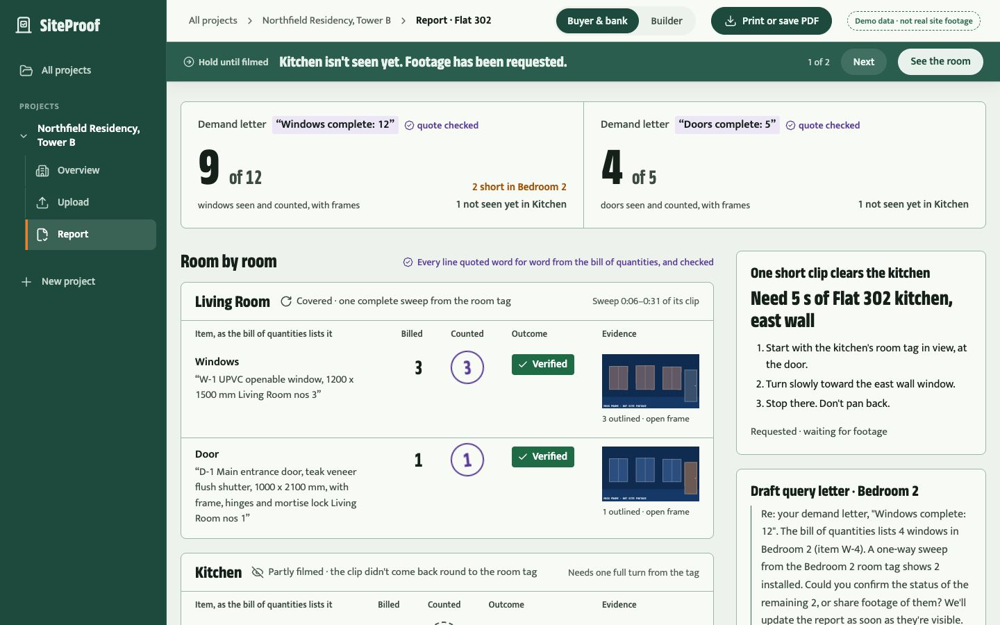
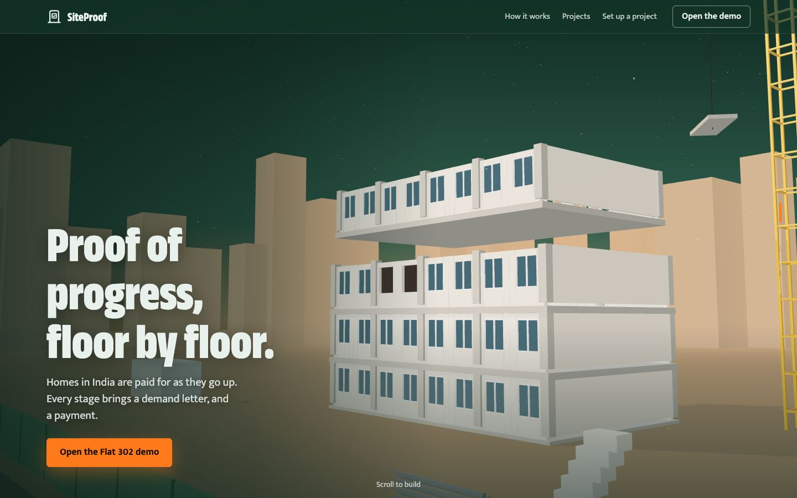
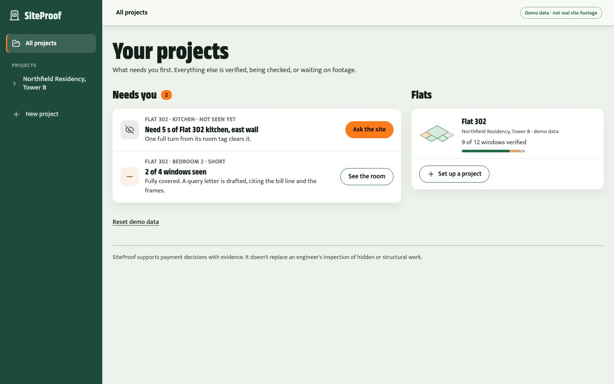
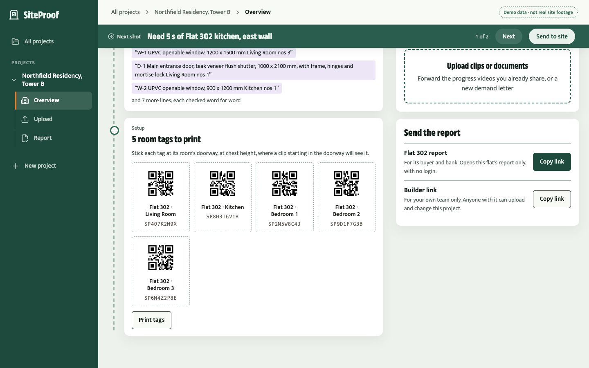
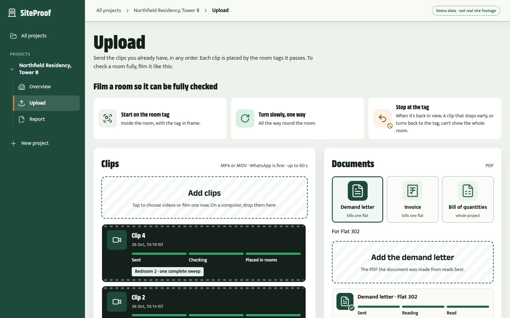
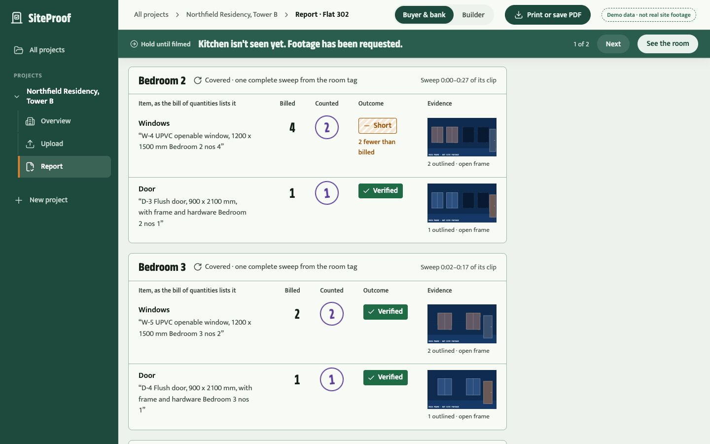
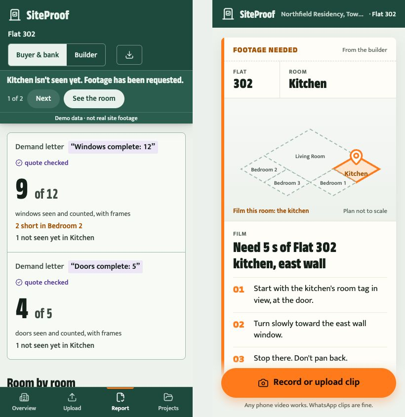
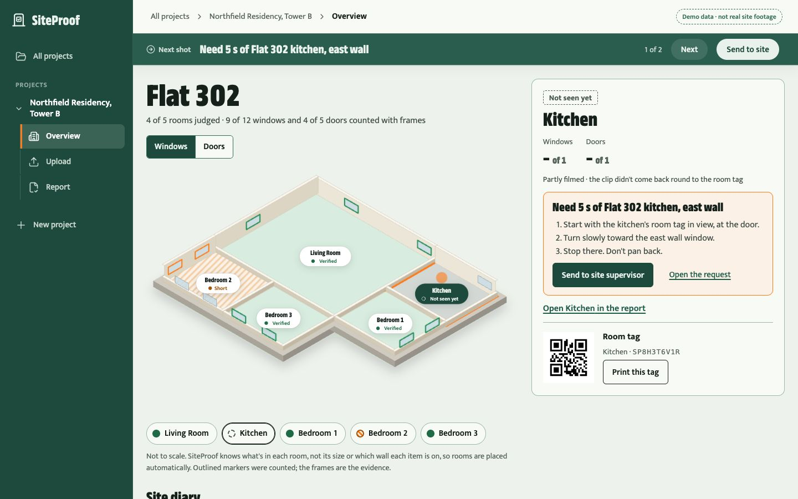

# SiteProof

**Verified construction progress from the footage builders already take.**

In India, homes under construction are paid for in stages. The builder sends a demand letter ("windows complete: 12, please pay stage 6"), and the buyer and the bank pay against that piece of paper. Buyers don't have the time or the expertise to check. Banks' engineers visit now and then. And by the next stage, the work is plastered over.

SiteProof takes the progress clips a builder already posts in the buyers' WhatsApp group and turns them into evidence. It reads the demand letter and the bill of quantities, counts the installed windows and doors it can see, and gives every claim one of three answers, **Verified**, **Short** or **Not seen yet**, with the frame and outline of every object it counted.

Built for the Meta Global AI Developer Hackathon, Indie track. **Live at [siteproof-alpha.vercel.app](https://siteproof-alpha.vercel.app).**



<sub>Screenshots use the demo flat, Flat 302, with drawn placeholder frames. No real site footage is in this repo.</sub>

## Who it's for

**Builders, first.** SiteProof is proof of progress that gets a builder paid faster, not a tool for catching cheats. Today an honest builder spends weeks chasing payments and answering "is it really done?" in buyers' WhatsApp groups, slowed down by distrust that dishonest builders created. With SiteProof the builder forwards the clips they already shoot, sees what is verified, and is told exactly which five-second shot would clear the rest: "Need 5 s of Flat 302 kitchen, east wall". Then they send buyers a verified report and get paid without the argument. That's why builders would want to send footage, and why it never feels like policing.

**Buyers** get a report for their own flat before they pay a demand letter, with frames for every verified item and a plain answer for everything else.

**Banks** get evidence for each stage release, an audit trail, and fewer site visits for their engineers.

SiteProof supports payment decisions with evidence. It does not replace an engineer's inspection of hidden or structural work.

## How it works

```
clips · demand letter · BOQ
        │
   1 Ingest   each clip stored with its own capture time; frames sampled
   2 Locate   printed QR room tags at each doorway place each clip by room
   3 Read     Muse Spark reads the documents into claims, every quote checked word for word
   4 Count    SAM 3.1 tracks each object, so a window passed three times counts once
   5 Compare  plain code, no model: claimed against counted against the plan
   6 Report   every count with its frames and outlines; gap requests; query letters
```

| Outcome | When | Shown as |
| --- | --- | --- |
| **Verified** | The count meets the claim | The frame and outline for every counted object |
| **Short** | Fewer seen than claimed, in a room that was filmed completely | The gap, the frames, and a polite, specific query letter |
| **Not seen yet** | The room wasn't filmed well enough to judge | An exact request for a five-second clip. Never an accusation |

## What it holds itself to

These are the rules SiteProof is built to. The document side and the comparison engine enforce them in code, with tests.

- **Models find, code decides.** SAM 3.1 counts and Muse Spark reads, but no model ever decides an outcome or produces a number a buyer or bank sees. Plain code compares.
- **No evidence, no number.** Every count links to its frames. Every claim carries its document line, quoted word for word and checked by code against the PDF's own text, never against text a model produced. The check forgives what PDFs really do, such as ligatures, column spacing and curly quotes, but there is no "close enough": `windows: 12` and `windows: 72` are one character apart.
- **Short only means short.** A shortfall is only reported for a room filmed completely, in one continuous sweep from its doorway tag. Anything less is **Not seen yet**, with a request for exactly the footage that's missing.
- **A claim is placed in a room only when its quoted line names that room.** A room read from a heading or a wrapped line has no evidence behind it, and the room decides which footage the claim is judged against.
- **Bad input gets a clear next step, never a crash or a silent zero.** A scanned PDF with no text, or a file that isn't a video, is refused at upload. A clip over a minute long is refused when it's processed. Either way, the builder gets plain words about what to send instead.

## How well it counts

> **Not written yet.** This section fills in after the site visit: SAM 3.1's counts against hand counts on 15–20 real clips, produced by `backend/scripts/accuracy.ts` (William and Furqaan, by 31 October).

The table will report over-counts and under-counts separately, by kind of clip, with every row shown. The two directions hurt different people. An over-count could mark a claim **Verified** for windows that aren't there, so money is released for nothing. An under-count could send a query letter to an honest builder. A single "found 97%" figure lets the two cancel each other out.

## Try it

**[siteproof-alpha.vercel.app](https://siteproof-alpha.vercel.app)**: press **Open the demo** for Flat 302's report, as a buyer or a bank receives it. No login: a report link opens one flat's report and nothing else.



The demo story, as a builder walks it:

**1. Know what needs you.** The projects list leads with what's open: a room not seen yet, a room that's short. Everything else is verified, being checked, or waiting on footage.



**2. Set up the flat and print its room tags.** Name the flat and its rooms; SiteProof makes one QR tag per room, printed at 100 mm and stuck at the doorway. Any clip that starts at a tag is placed in that room.



**3. Upload what you already have.** The demand letter, the bill of quantities, and the progress clips you already post for buyers, in any order. Each clip shows where it was placed and whether it swept its room completely.



**4. Read the report.** Every line of the demand letter, checked word for word, against what was counted in each room. **Verified** shows the frame and outline of every object counted. **Short** shows the gap and drafts a polite query letter, only for a room filmed completely. **Not seen yet** never accuses: it asks for one short clip.



**5. Clear what wasn't seen.** "Need 5 s of Flat 302 kitchen, east wall" goes to the site supervisor's phone with three filming steps. One clip from the room tag, and the kitchen is judged.



**6. See the flat.** The project page draws the flat with each room's state, the room tag and its gap request, and a diary of every clip and document as it came in.



To set up a project of your own on the live site you need the team's setup key. Every screen also runs on in-browser demo data with no backend at all: see the frontend steps below.

## Run it locally

You need [Bun](https://bun.sh) 1.4+, [pnpm](https://pnpm.io) 11, Docker, and on the `PATH` `ffmpeg`, `ffprobe`, poppler's `pdftotext` and zbar's `zbarimg` (`brew install ffmpeg poppler zbar`; on Ubuntu `apt install ffmpeg poppler-utils zbar-tools`). Chrome is needed only to re-render the sample documents.

```bash
pnpm install
cp backend/.env.example backend/.env    # fill it in: see the comments in the file
pnpm db:up                              # local Postgres. If 5432 is taken: POSTGRES_PORT=5435 pnpm db:up, and use :5435 in DATABASE_URL
pnpm --filter @siteproof/backend db:migrate
pnpm --filter @siteproof/backend dev    # the API and the job worker, on :4000
```

The secrets in `backend/.env` (`UPLOAD_TICKET_SECRET`, `LINK_SECRET`, `SETUP_KEY`) are any long random strings, different on every machine: `openssl rand -hex 32`. `.env` is gitignored, and this repo is public.

Load the demo project, Flat 302 with its rooms and the sample BOQ, demand letter and invoice, into the running backend:

```bash
cd backend && bun --env-file=.env scripts/seed-demo.ts
```

The frontend runs on its own, either on mock data or against the backend:

```bash
cp web/.env.example web/.env.local      # NEXT_PUBLIC_DATA_SOURCE=api to use the backend
pnpm --filter @siteproof/web dev
```

Tests and types, across the workspace:

```bash
pnpm test
pnpm typecheck
```

## Built with

| Job | Choice |
| --- | --- |
| Detecting, tracking and outlining windows and doors in shaky video | **SAM 3.1** (Meta). Its object tracks are what stop a window being counted twice; its masks are the evidence |
| Reading a whole demand letter, invoice or BOQ into claims in one pass | **Muse Spark** (Meta), held to a strict schema, every quote then checked by code |
| Room placement | Printed QR tags at each doorway, decoded from the footage |
| API and jobs | Hono on Bun, TypeScript; a jobs table in PostgreSQL through Prisma |
| Clips and documents | Cloudflare R2, private, reached only through short-lived signed links |
| Frontend | Next.js on Vercel |

## Repo map

| Path | What |
| --- | --- |
| [`web/`](web/) | The Next.js app: setup, uploads, reports |
| [`backend/`](backend/) | The API, the job worker, the video and document pipelines, the Prisma schema |
| [`backend/fixtures/documents/`](backend/fixtures/documents/) | The sample BOQ, demand letter and invoice, each marked as a sample with a fictional builder |
| [`contract/`](contract/src/index.ts) | The shapes the frontend and backend share |
| [`docs/`](docs/) | [The product brief](docs/PRODUCT.md), [the data contract](docs/data-contract.md), and every [decision record](docs/decisions/) |

## Team

Furqaan (lead: pipeline and verification), William (documents, data and the core API), Apurva (frontend, the report and the demo).
